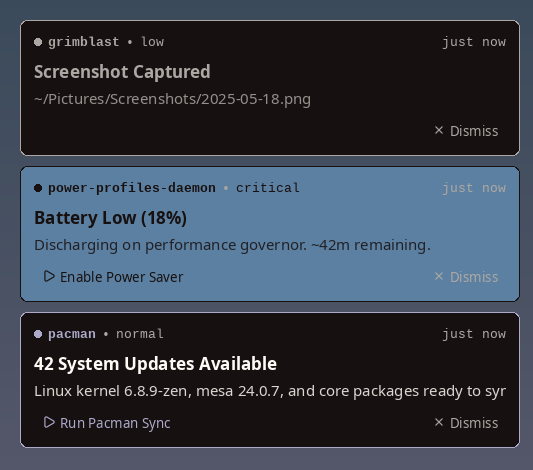
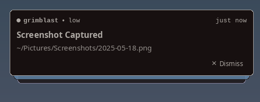

# nod

Suckless-style notification daemon for X11. Implements the
[Desktop Notifications Specification 1.2][spec] over D-Bus.

Think "herbe with native D-Bus support" — no wrapper scripts, works out
of the box with `notify-send` and any app that emits standard
notifications.

[spec]: https://specifications.freedesktop.org/notification-spec/notification-spec-latest.html

[Website and interactive demo](https://matteo.merola.co/nod/) ·
[Documentation](https://matteo.merola.co/nod/docs.html) ·
[Releases](https://github.com/mattmezza/nod/releases)

## Features

- Runtime settings in a single XDG `config.ini`
- Native D-Bus — no `herbe` wrapper, no FIFOs
- Cards drawn with [CUI](https://github.com/mattmezza/cui) and SDL3
- Header (app, urgency, relative time), summary, body, action buttons — each part toggleable
- Folding stack that unfolds on hover, animated entrance/exit, swipe to dismiss
- Multi-monitor aware (follows focused window via XRandR)
- Stacked notifications, configurable corner, rounded corners (X Shape)
- Theming from X resources, falling back to `*.background`, `*.foreground`
  and `*.colorN` — wallpaper palettes (pywal, wallust, …) just work
- Runtime theme reload (polling or `SIGUSR1`)
- Scheduled do not disturb, app muting, X11 tray toggle and `nod-dnd` CLI
- Recent notification history via `mwm-tray notifications`

## Install from GitHub Releases

On Linux x86_64 or ARM64, the installer can fetch the latest release once
its binary assets are available.

```sh
curl -fsSL https://raw.githubusercontent.com/mattmezza/nod/main/install.sh | sh
```

Use the same script to upgrade or uninstall.

```sh
curl -fsSL https://raw.githubusercontent.com/mattmezza/nod/main/install.sh | sh -s -- upgrade
curl -fsSL https://raw.githubusercontent.com/mattmezza/nod/main/install.sh | sh -s -- uninstall
```

The installer checks the archive's SHA-256 checksum and installs `nod`,
`nod-send`, `nod-dnd`, their man pages, and a sample configuration under `~/.local`. Put
`~/.local/bin` on your `PATH`. Set `NOD_PREFIX` in the shell running the
installer to use another absolute prefix, and use the same prefix on upgrade
and removal. Choose a free prefix if the default paths already contain a
source or package-manager installation. To select a release, pass its tag
after `install` or `upgrade`. Restart any running nod process after upgrading.

The prebuilt daemon is statically linked and uses SDL3's software renderer.
It needs an X11 session, a D-Bus session bus, and fonts discoverable through
Fontconfig. The companion scripts use `gdbus` and `dbus-send`. The installer
uses `curl`, `sha256sum`, `tar`, and `flock`.

## Build

Build from source to use SDL3's GPU renderer. Source builds require these
development headers and libraries.

- libX11, libXrandr, libXrender, libXext, fontconfig
- SDL3 >= 3.2, FreeType, HarfBuzz (for CUI)
- libdbus-1

On Arch, install them with `pacman -S libx11 libxrandr libxrender libxext fontconfig sdl3 freetype2 harfbuzz dbus`.

```sh
make
sudo make install
```

The first `make` downloads and verifies the pinned CUI source archive, generates
its native bundle, and compiles it into `build/libcui.a`. This bootstrap needs
`curl`, `sha256sum`, `tar`, and Python 3. Later builds use the local copy and
only rebuild changed sources.

## Configuration

Nod reads `${XDG_CONFIG_HOME:-$HOME/.config}/nod/config.ini` at startup.
[config.ini](config.ini) documents every setting and supplies the built-in
defaults. Copy it to your config directory, edit it, and restart nod.

```sh
config_dir="${XDG_CONFIG_HOME:-$HOME/.config}/nod"
mkdir -p "$config_dir"
cp -n config.ini "$config_dir/config.ini"
```

Installed copies of the sample live at `share/nod/config.ini` under the
installation prefix. Missing settings use the built-in defaults. Nod reports
invalid entries to stderr and continues with the valid settings. If you
previously customized `config.h`, transfer those values into the matching
INI sections. Keep only the keys you want to override if you want later
releases to supply the other defaults.

## CUI dependency

`vendor/cui-native/` is generated locally and ignored by Git. `cui.lock.mk`
pins the upstream commit and archive SHA-256. No globally installed CUI library
is needed. Run `make fetch-cui` to download it ahead of time; subsequent builds
work offline. `make distclean` keeps the downloaded dependency.

To update CUI, change both pins in `cui.lock.mk`, then run `make distclean`
and `make`. The downloader verifies the archive before running upstream's
Python bundle generator. It retains the source bundle's license and dependency
notices, removing only the unused starter app and fonts (nod uses fontconfig).

Release source archives include the pinned native bundle, so building a release
tarball needs neither network access nor Python.

## Release

Set `VERSION` in `config.mk` and `nod-send`, then commit the changes and
run the release target.

```sh
make release name=vX.Y.Z
```

The target requires authenticated GitHub CLI (`gh`) and push access to `origin`.
It checks the version and clean checkout, builds a fresh source extraction,
checks its version, runs the isolated Xvfb/D-Bus smoke test, and creates
`nod-X.Y.Z.tar.gz` with a SHA-256 sidecar.
It then creates an annotated tag, pushes the commit and tag, and publishes a
GitHub release containing both files. Release validation also needs `xvfb-run`,
`xauth`, `dbus-run-session`, `gdbus`, `dbus-send`, and `xrdb`.

When the release is published, GitHub Actions builds the tagged commit on
Linux x86_64 and ARM64. It checks both executables for dynamic dependencies,
runs the Xvfb/D-Bus smoke test, and attaches the
`nod-linux-{x86_64,aarch64}.tar.gz` archives and their `.sha256` files to
that release. The installer can fetch the binaries once this workflow finishes.

## Theming via X resources

With `use_xresources = 1` (default) nod reads, per urgency
(`low`, `normal`, `critical`):

| what | resource | falls back to |
| --- | --- | --- |
| card background | `nod.background.<u>` | `nod.background`, `*.background` |
| text | `nod.foreground.<u>` | `nod.foreground`, `*.foreground` |
| border, dot, buttons | `nod.accent.<u>` | `nod.border.<u>`, `*.color8` / `*.color4` / `*.color1` |
| secondary text | `nod.muted` | `*.color8` |
| fonts | `nod.font`, `nod.monoFont` | `[theme]` in `config.ini` |

Font sizes in points are resolved at `Xft.dpi` (96 when unset), like Xft.
Accent, text and muted colours are nudged towards the foreground until they
reach `min_contrast` against the card, so arbitrary palettes stay readable;
critical cards are tinted with their accent (`critical_tint`).

With a compositor (picom, …) nod uses a 32-bit window: real transparency and
antialiased corners. Without one it falls back to a Shape mask. Exclude
nod from compositor blur/rounding, e.g. for picom:

```
blur-background-exclude = [ "class_g = 'nod'" ];
rounded-corners-exclude = [ "class_g = 'nod'" ];
```

So a wallpaper-generated palette works with no nod entries at all. Override
only what you want:

```
nod.font:            Noto Sans:size=11
nod.monoFont:        JetBrains Mono:size=10
nod.accent.critical: #cc241d
```

nod polls the resource database every `xresources_poll_ms` (default 2000)
and repaints when it changes; `xresources_poll_ms = 0` disables polling,
then use `killall -USR1 nod`.

## Run

```sh
# Start from ~/.xinitrc or equivalent, before your WM:
nod &
exec dwm
```

Only one notification daemon can own the name
`org.freedesktop.Notifications` at a time — make sure `dunst`, `mako`,
or any DE daemon is not running.

## nod-send

A `notify-send`-compatible CLI wrapper shipped alongside nod. Adds
support for the `-A/--action` flag (upstream `notify-send` already has
this, but `libnotify`-less systems may not). Installed to
`$(PREFIX)/bin/nod-send`. Depends on `gdbus` (from `glib2`).

```sh
# basic — identical to notify-send
nod-send "Hello" "This is a test"
nod-send -u critical -t 3000 "Critical" "Server down"

# with a default action — blocks until dismissed, prints "default" if clicked
key=$(nod-send -A "Open" "New mail" "Click to open inbox")
[ "$key" = "default" ] && xdg-open https://mail.example.com

# named actions
nod-send -A open="Open" -A snooze="Snooze" "Reminder" "Meeting in 5min"
```

The wait is bounded: `expire-time + 3s` slack for finite timeouts,
unbounded for persistent (`-t 0`).

## Test

```sh
notify-send "Hello" "This is a test"
notify-send -u low "Low" "Low urgency"
notify-send -u critical "Critical" "Critical urgency"
notify-send -t 3000 "Quick" "3 second timeout"

# Replace an existing notification
notify-send -r 1 "Updated" "Replaced notification"

# Notification with a default action
gdbus call --session \
    --dest org.freedesktop.Notifications \
    --object-path /org/freedesktop/Notifications \
    --method org.freedesktop.Notifications.Notify \
    "test" 0 "" "Click me" "Has default action" \
    '["default", "Open"]' '{}' -1
```

There is also an isolated Xephyr test for X resources reload:

```sh
./tests/test_xresources.sh
```

## Interaction

- **Stack** — several notifications fold into a deck; hover to unfold it
- **Action buttons** — one per action (max 3); emits `ActionInvoked`, then dismisses.
  With `action_buttons = 0` a left click on the card invokes the default action
- **Dismiss** button, **right-click**, or **swipe** (drag or two-finger
  touchpad swipe towards the screen edge) — dismiss only
- **Hover** — holds every timeout while the pointer is over the stack
- **Timeout** — auto-dismiss

Card parts (app name, urgency, time, dividers, buttons, border), stacking and
motion are configured in `config.ini`.

## What nod does NOT do

Icons. Markup. Sound. CLI flags beyond `-v`.
Focus stealing. Wayland.

If you want those, use `dunst`.

## Screenshot



Folded (default when more than one notification is shown):



## License

MIT — see `LICENSE`.

## Website

The static marketing and documentation site is in `web/`. Build it with
Node.js 24+ and npm:

```sh
make site
python3 -m http.server 4173 -d web/dist
```

Tailwind CSS is compiled locally; the published site has no runtime CSS CDN
dependency. `.github/workflows/pages.yml` builds and deploys `web/dist` to
GitHub Pages on changes to the site on `main`. Pull requests build without
deploying. See `web/README.md` for editing and previewing the site.

### Do not disturb

Click nod's circle icon in an XEmbed system tray to toggle do not disturb.
A slash means DND is on. The icon appears when an X11 system tray is available.
From a terminal or script, run `nod-dnd` (toggle), `nod-dnd on`,
`nod-dnd off`, or `nod-dnd status`; each prints `on` or `off`. The command
requires `dbus-send` and a running nod daemon.

Set days in the `[dnd]` section of `config.ini` and restart nod. Use `off` or
`HH:MM-HH:MM` in local time. An end before the start crosses midnight. Equal
times disable the interval. Manual changes last until the scheduled state next
changes or nod restarts. When the schedule changes the DND state, nod shows a
notification with a button to reverse it and updates the tray icon.
`monday = 22:00-07:30` mutes from Monday 22:00 until Tuesday 07:30.

Add one `muted_app = App Name` entry per app in `[dnd]` to mute it at all times.
Matching uses exact app names and ignores case. DND and app muting suppress
new banners, including critical ones. Displayed cards remain until dismissed
or expired.

### Notification history

nod keeps the 50 most recent notifications in memory, including notifications
received during Do Not Disturb. Entries from explicitly muted apps and
notifications with the `transient` hint are excluded. Use
`nod-send --transient` to skip history for a message. History is cleared when
nod exits.

On the notifications object, `org.nod.History.List` returns newest first as
`a(utysss)`: notification ID, Unix time in microseconds, urgency, app, summary,
and body. `Remove(u)` removes one entry and `Clear()` removes all entries.
`org.nod.History.Changed` and `org.nod.Dnd.Changed` signal state updates without
including notification content.

Run `mwm-tray notifications` on the same X screen and session bus to use an
unread bell, recent history panel, and Do Not Disturb toggle. nod's tray icon
returns when the applet exits. [mwm](https://github.com/mattmezza/mwm)
